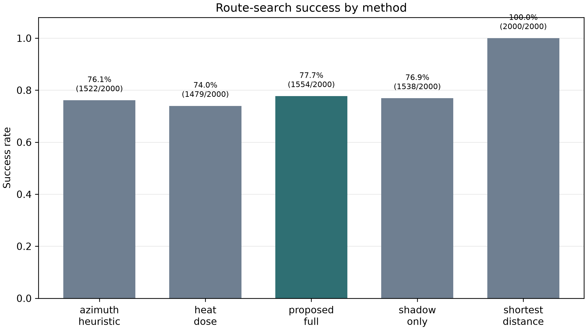
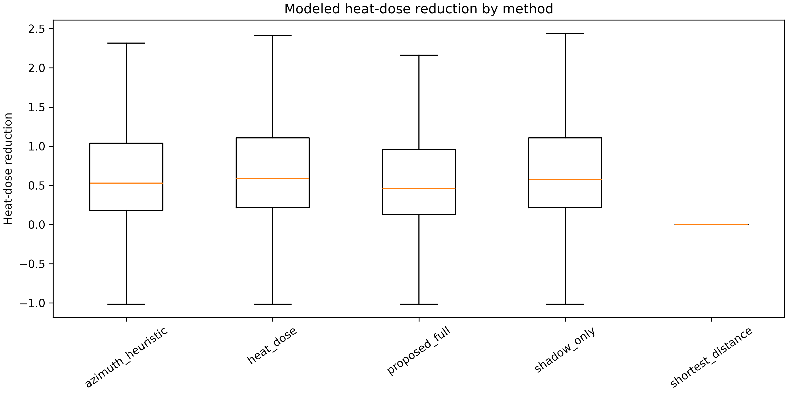
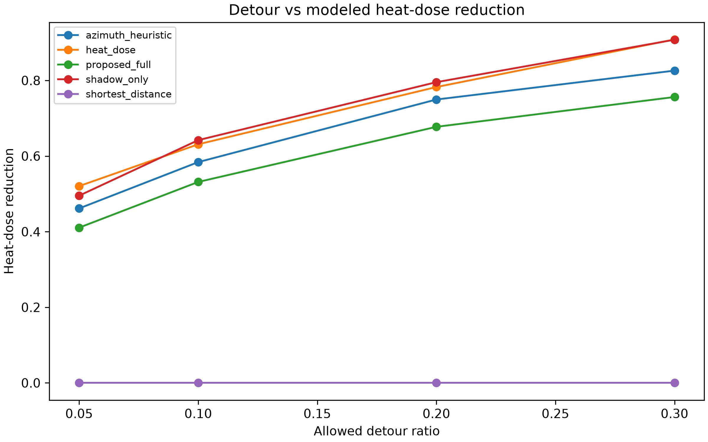

# Detour-Constrained Radiative Routing for Heat-Aware Pedestrian Navigation: A Washington, DC Pilot Study

## Abstract

Urban pedestrian route choice during hot conditions can be improved by routing engines that reason about heat exposure, shade, and acceptable detours together. This paper presents a computational pilot study of a raster-backed pedestrian routing pipeline for Washington, DC. The system combines an OSM-derived walking graph, modeled UTCI, a direct-shadow raster, LiDAR-derived urban form layers, land cover, and traffic-volume proxies into edge-level route features. Routes are searched under explicit detour budgets so that heat-aware alternatives remain bounded relative to the shortest path.

We evaluate 500 origin-destination pairs at a single modeled snapshot, June 19, 2026 at 14:00 local time, across four detour budgets and five routing methods. The benchmark produced 10,000 attempted route rows and 8,093 successful route rows. Among successful comparable rows, heat-dose and shadow-only objectives achieved the largest mean modeled heat-dose reductions relative to shortest paths, while the proposed full model produced smaller thermal reductions but the highest success rate among non-shortest methods and a balanced multi-feature route objective. These results should be read as an experimental systems pilot, not as field validation or proof that one preference model dominates all baselines.

## 1. Introduction

Pedestrian heat exposure is increasingly relevant for trip planning, public-space access, and urban climate adaptation. Shortest-path routing is easy to compute and explain, but it can route pedestrians through sun-exposed corridors when shaded alternatives exist nearby. At the same time, a heat-aware route that adds large distance or runtime burden may be unacceptable in practice. A useful routing system therefore needs two properties at once: spatially detailed exposure estimates and explicit control over detour cost.

This work studies that combination in a reproducible routing benchmark. The system samples modeled UTCI and direct-shadow rasters along graph edges, fuses those measurements with other route features, and searches for alternatives that satisfy a hard maximum-distance constraint. The contribution is not a final claim about real pedestrian comfort. Instead, it is a pilot-scale experimental system that asks whether a bounded-detour route engine can surface cooler or more shaded alternatives under a fixed microclimate snapshot.

The study makes three contributions:

1. A raster-backed feature extraction and routing pipeline that evaluates pedestrian routes using modeled UTCI, direct shadow, canopy/building/terrain features, and traffic proxies.
2. A detour-constrained route search setup that reports failures explicitly when a method cannot find a route within the configured search budget.
3. A 500-pair Washington, DC benchmark with method-comparison tables and figures saved as reusable manuscript assets.

## 2. System Overview

The routing graph is loaded from a walking-network GraphML file. Each candidate edge is represented by its geometry, length, and derived route features. Edge geometries are densified at a configured spacing of 20 m for raster sampling. UTCI and direct-shadow values are sampled at the densified points, transformed into edge-level metrics, and then accumulated over full routes.

The core route feature vector includes distance, travel time, mean UTCI, maximum UTCI, heat dose, shade fraction, sunlit fraction, scenic proxy, traffic/noise proxy, slope penalty, elevation change, and uncertainty terms. Heat dose is defined as the mean positive exceedance above the comfort threshold:

```text
heat_dose = mean(max(0, UTCI - comfort_threshold_c))
```

For this benchmark, the comfort threshold is 26.0 C. The direct-shadow raster is interpreted as a binary or near-binary SOLWEIG-style field where values at or below 0.5 indicate shade and values above 0.5 indicate sun exposure.

The proposed route cost uses a weighted preference model. The current implementation includes a tunable shade weight, so direct sun exposure can be emphasized independently from the broader UTCI and heat-dose terms. The full preference model is intentionally a composite objective: it is not expected to maximize a single thermal metric in every case.

## 3. Data and Experiment Design

The benchmark uses a Washington, DC snapshot with the following inputs:

| Input | Role |
|---|---|
| `data/processed/streets/dc_walk_graph.graphml` | Walking graph and network distances |
| `data/processed/solweig_outputs/utci_2026-06-19_14.tif` | Modeled UTCI raster |
| `data/processed/solweig_outputs/shadow_2026-06-19_14.tif` | Direct-shadow raster |
| `data/processed/rasters/dem_1m.tif` | Elevation sampling |
| `data/processed/rasters/canopy_height_1m.tif` | Canopy proxy |
| `data/processed/rasters/landcover_1m_center_tile.tif` | Land-cover proxy |
| `data/processed/solweig_inputs/building_dsm_1m.tif` | Building-height proxy |
| `data/raw/traffic_noise/ddot_traffic_volume_2023.geojson` | Traffic/noise proxy |

Origin-destination pairs are sampled inside the graph and raster coverage. The main benchmark uses 500 OD pairs with shortest-path network distances between 400 m and 3,000 m. Each pair is evaluated at detour ratios of 0.05, 0.10, 0.20, and 0.30, producing 2,000 attempted rows per method.

The evaluated methods are:

| Method | Description |
|---|---|
| `shortest_distance` | Length-only shortest path |
| `azimuth_heuristic` | Solar-geometry shade heuristic without the direct-shadow raster |
| `shadow_only` | Route search emphasizing direct-shadow-derived shade |
| `heat_dose` | Route search emphasizing threshold exceedance |
| `proposed_full` | Composite radiative, perceptual, slope, time, distance, and uncertainty objective |

All constrained searches use a 1.5 s per-route search budget, 20,000 maximum expansions, and 8 labels per node. A failed row is retained when search exceeds these limits before finding a route inside the detour budget.

## 4. Results

The main method-comparison table is saved at `paper_assets/main_method_comparison.csv`. The proposed detour tradeoff table is saved at `paper_assets/detour_tradeoff.csv`.

### 4.1 Search Success

The benchmark attempted 10,000 route rows: 500 OD pairs, four detour ratios, and five methods. The shortest-distance baseline succeeded for all 2,000 rows. Constrained heat-aware methods had lower success rates because they had to find an alternative route inside both the detour constraint and search budget.



| Method | Attempted rows | Successful rows | Success rate |
|---|---:|---:|---:|
| `shortest_distance` | 2,000 | 2,000 | 100.0% |
| `proposed_full` | 2,000 | 1,554 | 77.7% |
| `shadow_only` | 2,000 | 1,538 | 76.9% |
| `azimuth_heuristic` | 2,000 | 1,522 | 76.1% |
| `heat_dose` | 2,000 | 1,479 | 74.0% |

Most failed rows were expansion-budget failures. This is an important systems result: thermal objectives can increase route-search difficulty under tight detour constraints, so success rate and runtime should be reported alongside exposure metrics.

### 4.2 Method Comparison

Among successful comparable rows, all non-shortest methods reduced modeled heat dose and mean UTCI relative to the shortest path. The largest thermal reductions came from single-purpose thermal objectives, not from the proposed composite model.



| Method | Mean heat-dose reduction | Mean heat-dose reduction | Mean UTCI reduction | Shade-fraction increase | Mean excess distance | Median runtime |
|---|---:|---:|---:|---:|---:|---:|
| `heat_dose` | 0.710 C | 14.8% | 0.717 C | 0.105 | 9.57% | 271 ms |
| `shadow_only` | 0.706 C | 14.7% | 0.713 C | 0.109 | 9.66% | 272 ms |
| `azimuth_heuristic` | 0.656 C | 13.6% | 0.663 C | 0.477 | 9.16% | 284 ms |
| `proposed_full` | 0.597 C | 12.4% | 0.604 C | 0.089 | 8.93% | 259 ms |
| `shortest_distance` | 0.000 C | 0.0% | 0.000 C | 0.000 | 0.00% | 229 ms |

This pattern supports a narrower interpretation than "the proposed method beats every baseline." The proposed full model is better understood as a multi-objective routing policy that trades some thermal optimization for a broader objective including shade, scenic and noise proxies, slope, travel time, distance, and uncertainty. In this run, it had the best success rate among non-shortest methods and the lowest mean excess distance among the non-shortest methods, but it did not maximize heat-dose reduction.

### 4.3 Detour Tradeoff for the Proposed Full Model

For `proposed_full`, larger detour budgets increased modeled heat-dose reduction. The trend is monotonic in the aggregate table, with mean heat-dose reduction rising from 0.411 C at a 5% detour budget to 0.756 C at a 30% detour budget.



| Detour budget | Successful rows | Mean heat-dose reduction | Mean heat-dose reduction | Mean excess distance | Median runtime |
|---|---:|---:|---:|---:|---:|
| 5% | 401 | 0.411 C | 8.5% | 3.37% | 214 ms |
| 10% | 349 | 0.531 C | 11.1% | 6.37% | 222 ms |
| 20% | 376 | 0.677 C | 14.0% | 10.89% | 277 ms |
| 30% | 428 | 0.756 C | 15.5% | 14.50% | 352 ms |

This result is consistent with the design goal of bounded-detour routing: the amount of allowable extra walking distance materially changes the attainable exposure reduction. It also suggests that a single "coolest route" result is less useful than a tradeoff curve.

### 4.4 Preference Tuning Pilot

A focused tuning run evaluated four `proposed_full` weight variants on a 100-pair subset at 10% and 20% detour budgets. The current balanced weights produced a mean heat dose of 4.0516 among successful rows. More heat- and shade-heavy variants reduced this slightly, with the shade-heavy variant reaching 3.9984 mean heat dose and 0.4172 mean shade fraction. The differences are small and should be interpreted as tuning signals rather than final evidence.

The most useful result from the tuning pilot is architectural: exposing shade as its own preference weight makes it possible to tune sun-exposure aversion separately from UTCI-derived thermal terms.

## 5. Discussion

The benchmark shows that modeled heat exposure can be reduced within explicit detour budgets for many OD pairs, but it also shows why route-system papers should report more than a single best metric. Thermal objectives, detour constraints, and search budgets interact. A method can look strong on heat-dose reduction while failing more often, or it can be more robust while giving up some thermal benefit.

The proposed full method occupies the latter role in this pilot. It did not outperform heat-dose or shadow-only baselines on mean modeled heat-dose reduction. However, it provided a more comprehensive route objective, achieved the highest non-shortest success rate, and maintained slightly lower mean excess distance than the thermal-only alternatives. For a deployed pedestrian assistant, that tradeoff may be preferable when users care about a mix of heat, shade, walking burden, traffic proxy, slope, and general route quality.

The azimuth heuristic result is also informative. It achieved a large shade-fraction increase, but lower heat-dose reduction than the heat-dose and shadow-only objectives. This supports the need to evaluate direct thermal metrics rather than treating geometric shade as a complete proxy for route comfort.

## 6. Limitations

This study is a modeled computational pilot. It does not validate pedestrian thermal comfort in the field, does not measure physiological outcomes, and should not be presented as medical or safety guidance.

The benchmark uses one city and one timestamp: Washington, DC on June 19, 2026 at 14:00 local time. Results may change under different weather, solar geometry, seasons, neighborhoods, or pedestrian populations. The UTCI and direct-shadow fields inherit uncertainty from the source rasters and microclimate model. Scenicness, quietness, and uncertainty are proxy features rather than directly validated perception measures.

Search failures are part of the result. A route method that exceeds the expansion budget may still have a feasible route under a different algorithm or larger compute budget. Future work should separate algorithmic incompleteness from true absence of a feasible route inside the detour constraint.

Finally, the experiment evaluates route metrics, not user acceptance. A 10% detour may be acceptable for one trip and unacceptable for another. Accessibility, mobility impairments, sidewalk quality, crossings, safety, and personal risk tolerance need to be incorporated before this type of system can support public recommendations.

## 7. Conclusion

This pilot demonstrates a reproducible experimental pipeline for heat-aware pedestrian routing under hard detour budgets. In a 500-pair Washington, DC benchmark, thermal and shade-focused methods reduced modeled heat exposure relative to shortest paths, while the proposed full model provided a balanced multi-feature objective with the highest success rate among non-shortest methods. The strongest claim supported by the results is not that one proposed method dominates all baselines, but that raster-backed, detour-constrained routing is a practical framework for studying exposure tradeoffs.

The next step is to expand from a single modeled snapshot to multi-time, multi-weather benchmarks and to pair computational outputs with field observations or user studies.
